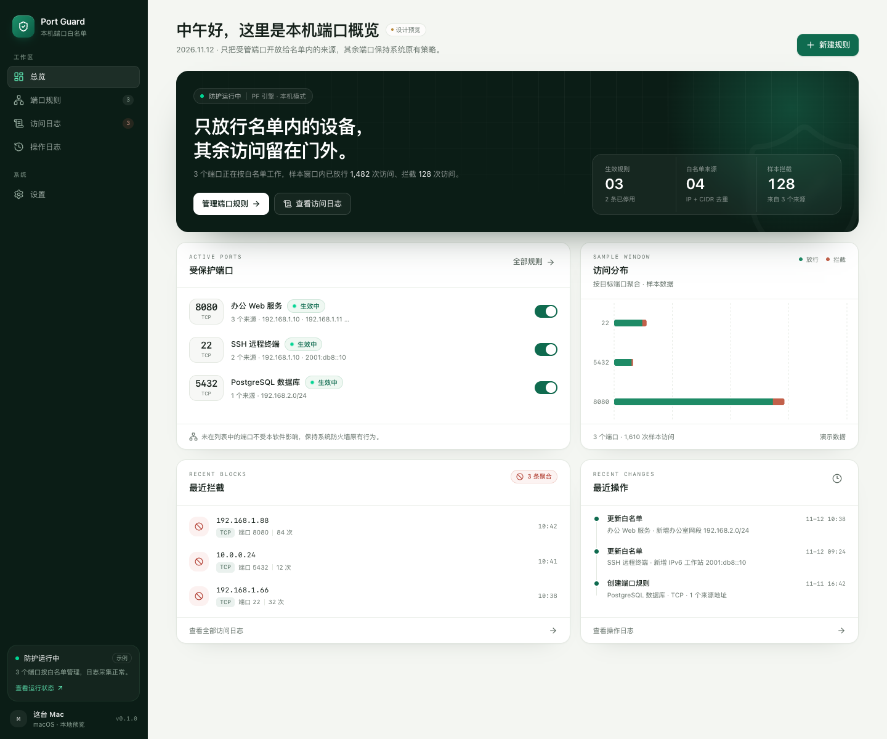
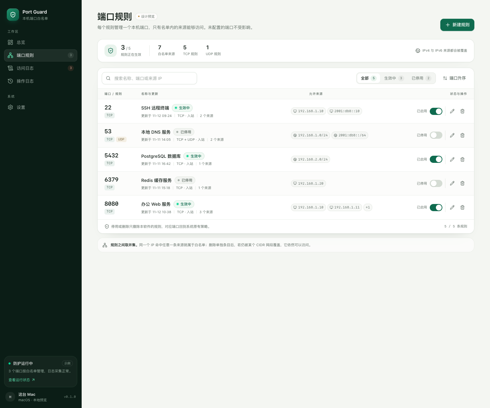
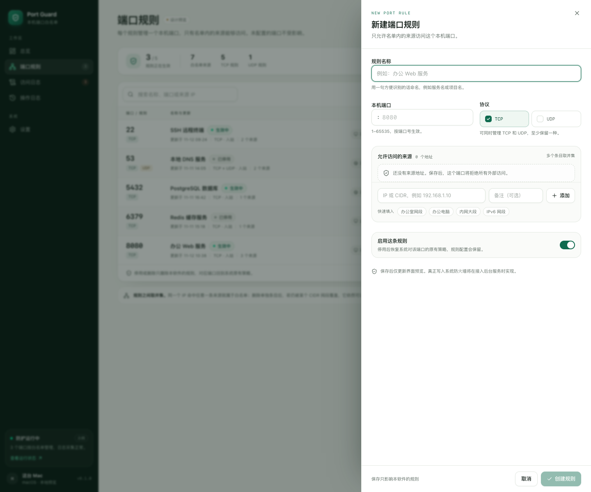
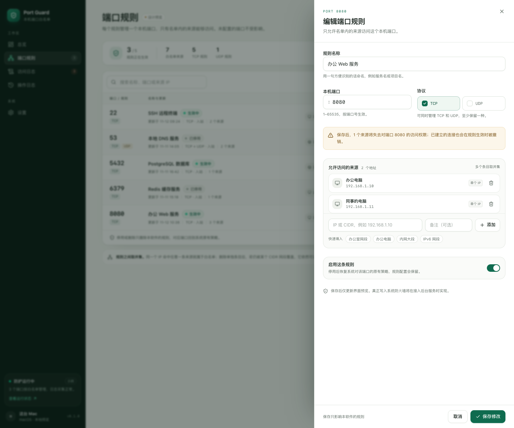
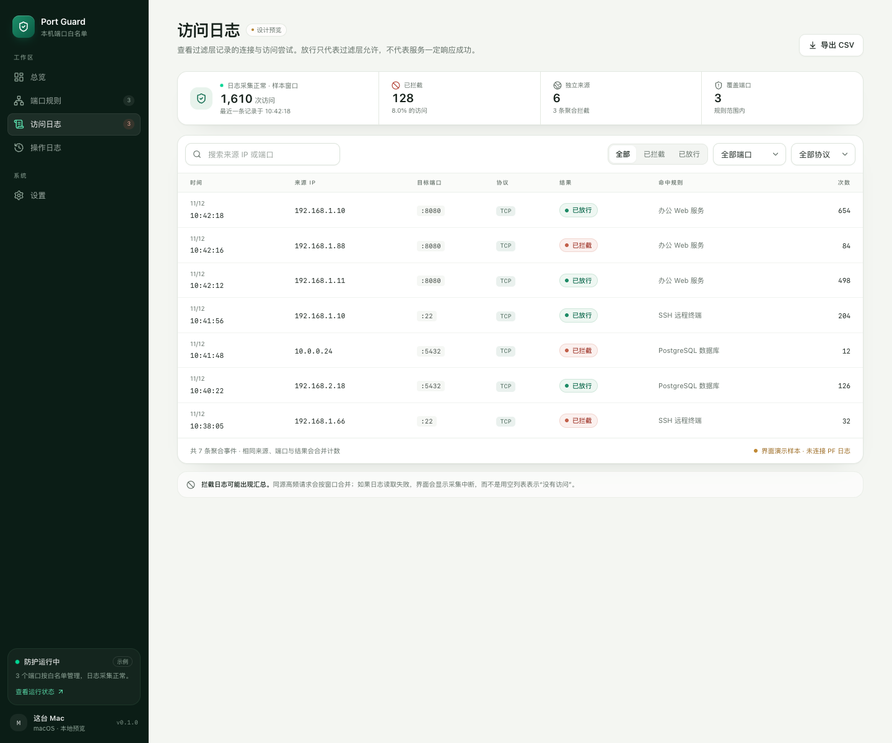
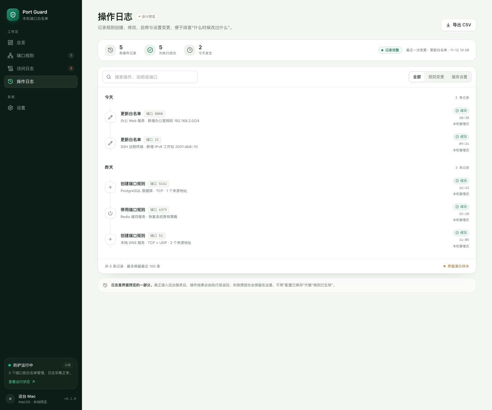
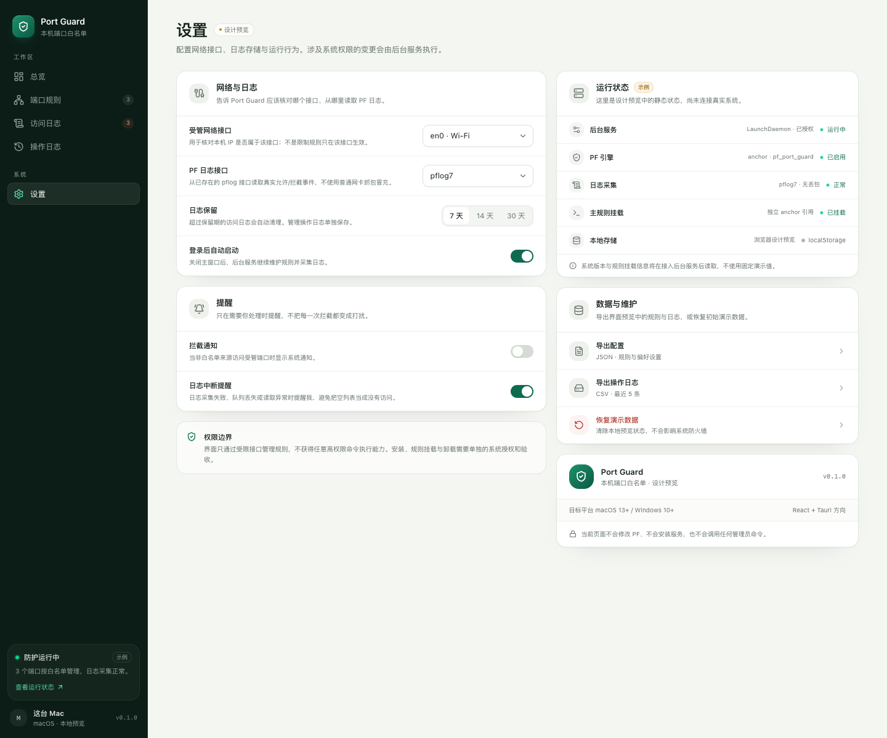
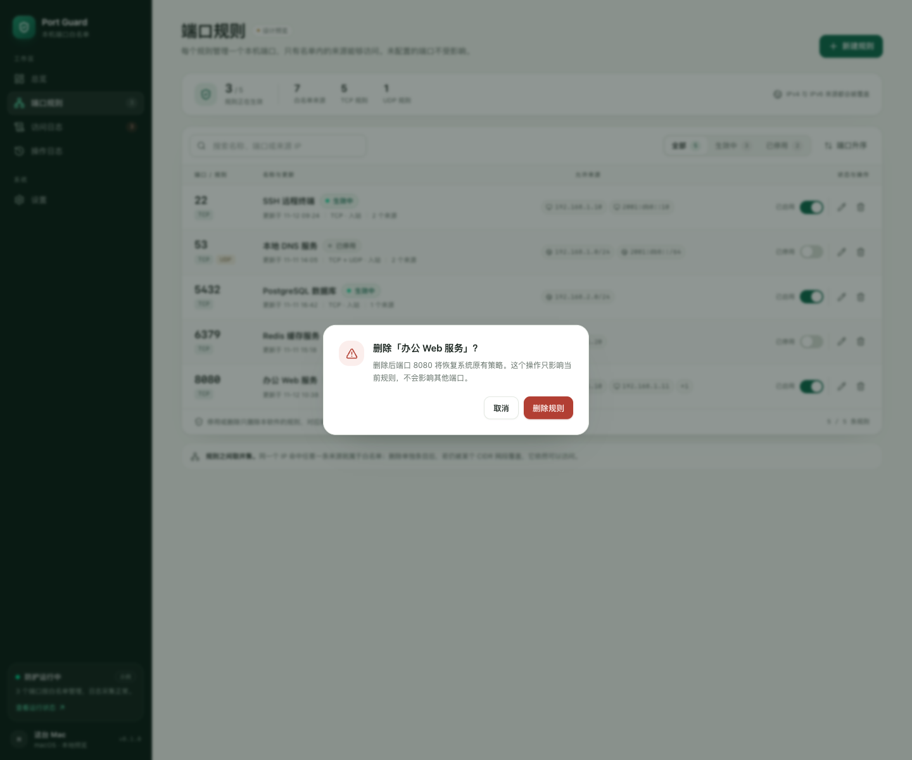
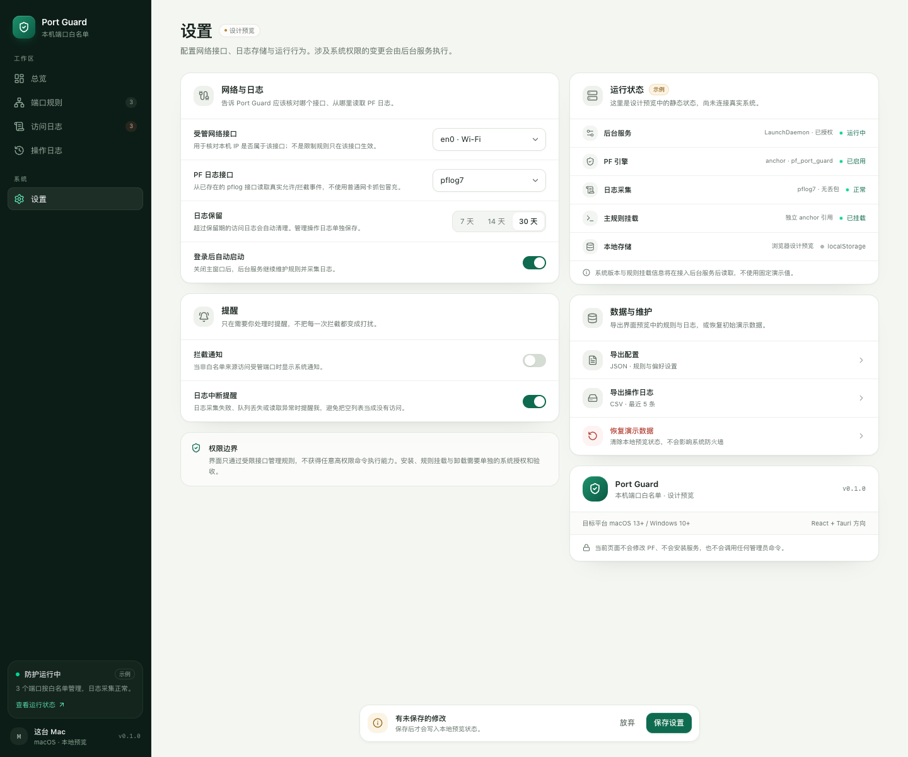

# Port Guard 界面设计

日期：2026-11-12

状态：页面设计稿与可交互预览已完成；Tauri 2 桌面壳与 SQLite 本地存储已接入（2026-11-12）。同日完成界面重构：Tailwind CSS 4 + Radix UI（shadcn/ui 风格源码）+ Motion + Zustand + TanStack Query + Recharts。系统过滤层与后台服务仍未接入。本文描述信息架构、页面内容、关键状态和视觉规范，供评审后再进入执行层联调。

## 1. 设计目标

Port Guard 的界面不是通用防火墙控制台，而是一个**按端口管理白名单**的本机工具。设计围绕三个问题展开：

1. 现在哪些端口正在被管理，谁可以访问？
2. 刚才发生了什么，为什么被拦截？
3. 修改规则后，影响范围是什么？

因此界面采用“总览 → 规则 → 日志 → 设置”的窄导航结构，默认落在总览页；规则编辑使用右侧抽屉，避免离开列表上下文。

### 设计原则

- **先说明状态，再提供操作。** 每个页面顶部先回答“现在怎么样”，操作按钮放在右侧。
- **不把“已保存”说成“已生效”。** 演示状态统一标注“设计预览 / 示例”，执行结果与访问结果分开表达。
- **默认克制。** 浅色工作区 + 深绿侧栏，只在运行状态、主操作和危险操作上使用强调色。
- **对撤销保持敏感。** 从已启用规则中移除来源时，明确提示已有连接也会被撤销。

## 2. 信息架构

```text
Port Guard
├─ 工作区
│  ├─ 总览          #/overview
│  ├─ 端口规则      #/rules
│  ├─ 访问日志      #/access
│  └─ 操作日志      #/operations
└─ 系统
   └─ 设置          #/settings
```

侧栏底部常驻运行状态摘要和当前设备信息。窗口宽度低于 1024px 时侧栏收为底部标签栏；1024–1279px 保留侧栏，但总览和设置使用单列，避免卡片被压窄。

## 3. 页面设计

### 3.1 总览



| 区域 | 内容 | 目的 |
| --- | --- | --- |
| 页头 | 问候语、日期、新建规则 | 给出今天的状态和主要入口 |
| 防护主卡 | 运行状态、PF 引擎、放行/拦截计数、两个主行动 | 用一句话说明当前保护范围 |
| 受保护端口 | 生效规则列表、来源摘要、启停开关 | 快速确认哪些端口正在被管理 |
| 最近拦截 | 来源、协议、端口、次数、时间 | 让异常访问第一眼可见 |
| 最近操作 | 最近三条规则或设置变更 | 回答“刚刚改过什么” |

主卡使用深绿渐变、低对比网格和柔光，是全页唯一的深色区域，用来建立“防护正在运行”的视觉锚点；规则全部停用时自动切换为“防护已暂停”。指标使用等宽数字，避免计数跳动时布局抖动。访问分布图随总览懒加载，图表只呈现样本数据。

### 3.2 端口规则



- **摘要条**：生效规则数、白名单来源数、TCP/UDP 规则数、IPv4/IPv6 覆盖说明。
- **工具栏**：名称/端口/来源搜索，全部/生效中/已停用筛选，端口升降序。
- **规则行**：端口与协议、规则名称与更新时间、来源地址（最多展示两个，其余折叠为 `+N`）、启停开关、编辑/删除。
- **页脚提示**：停用或删除只撤除本软件规则，端口回到系统原有策略。
- **底部说明**：多个来源取并集，CIDR 覆盖关系不会被界面“猜测”。

空状态区分“还没有规则”和“筛选后没有结果”，后者提供清除筛选按钮。

### 3.3 新建 / 编辑规则



右侧抽屉宽度 560px，表单分为四段：

1. **规则名称**：用于识别服务，不参与匹配。
2. **端口与协议**：端口 1–65535；TCP/UDP 至少保留一种；同端口同协议重复时即时提示冲突并禁用保存。
3. **允许来源**：支持单 IP 与 CIDR，带快速填入；地址会规范化、去重；空列表时提示“将拒绝所有外部访问”。
4. **启用状态与保存说明**：停用后保留配置；保存只更新界面预览。

编辑已启用规则并移除来源时，表单顶部出现琥珀色影响提示：



> 保存后，N 个来源将失去对端口 N 的访问权限；已建立的连接也会在规则生效时被撤销。

这条提示对应首版规格中的“撤销权限”要求，避免用户把删除来源理解为只影响下一次连接。

### 3.4 访问日志



- 顶部摘要：日志采集状态、样本窗口总访问量、拦截占比、独立来源数、覆盖端口数。
- 工具栏：来源/端口搜索、全部/已拦截/已放行、目标端口、协议筛选。
- 表格列：时间、来源 IP、目标端口、协议、结果、命中规则、次数。
- 结果用“已放行 / 已拦截”徽标区分；点击来源可把该 IP 填入搜索。
- 底栏明确标注“界面演示样本 · 未连接 PF 日志”，避免把静态列表当成真实采集结果。

设计约定：**空列表不等于没有访问。** 采集失败时应显示独立的中断状态和原因，不能复用空状态。

### 3.5 操作日志



- 按天分组的时间线，展示创建、更新、启停、删除和设置变更。
- 每条记录包含操作类型、端口、详情、结果、时间和操作者。
- 支持关键词搜索、规则变更/服务设置筛选和 CSV 导出。
- 失败记录使用红色结果标记；设计上预留了失败原因的位置。

操作日志回答“谁在什么时候改了什么”，不替代访问日志。

### 3.6 设置



- **网络与日志**：受管网络接口、PF 日志接口、日志保留 7/14/30 天、登录后自动启动。
- **提醒**：拦截通知、日志中断提醒。
- **运行状态**：后台服务、PF 引擎、日志采集、主规则挂载；明确标注“示例”。
- **数据与维护**：导出配置 JSON、导出操作日志 CSV、恢复演示数据。
- **保存语义**：桌面端先显示“正在写入本机 SQLite”，写入完成后才显示“已保存”；失败时保留错误状态和 toast，不用成功文案掩盖。
- **权限边界横幅**：界面只通过受限接口管理规则，不获得任意高权限命令执行能力。
- 有未保存修改时，底部出现浮动保存条；保存后按真实写入状态显示“正在写入 / 已保存 / 写入失败”，不宣称系统规则已变更。

## 4. 关键交互

| 场景 | 反馈 |
| --- | --- |
| 新建规则 | 右侧抽屉；名称为空、端口非法、协议为空、端口/协议冲突时禁用保存并给出原因 |
| 添加来源 | 即时校验 IPv4/IPv6/CIDR；规范化网段；重复地址拒绝；支持回车添加 |
| 移除来源 | 编辑已启用规则时提示影响范围；来源列表即时更新 |
| 启停规则 | 开关立即切换；写入演示操作日志并显示 toast；不弹确认框 |
| 删除规则 | 危险确认对话框，说明端口将回到系统原有策略 |
| 日志筛选 | 结果/端口/协议/关键词组合过滤；空结果提供清除筛选 |
| 导出 | 访问日志和操作日志导出带 BOM 的 CSV；配置导出 JSON |
| 设置修改 | 显示未保存保存条；保存后写入 localStorage 并记录操作 |
| 恢复演示数据 | 危险确认；只重置浏览器本地预览 |

删除确认对话框：



设置页有未保存修改时的粘性保存条：



## 5. 视觉规范

### 实现栈

- Tailwind CSS 4 令牌集中在 `ui/src/index.css`；Radix UI 原语以 shadcn/ui 风格源码放在 `ui/src/components/ui/`，可直接修改。
- Motion 负责页面过渡、侧栏活动指示和保存条；Sonner 负责 toast；Recharts 负责访问分布。
- Zustand 持有规则、操作日志和偏好；TanStack Query 负责 Tauri SQLite 首次水合、加载与错误状态。
- 图标使用 Lucide React；端口、IP、计数和时间戳使用系统等宽字体栈。

### 色彩

| 用途 | 色值 |
| --- | --- |
| 页面背景 | `#f4f6f2` |
| 卡片表面 | `#ffffff` |
| 主文字 | `#16211b` |
| 次级文字 | `#616e66` |
| 品牌绿 | `#0f6b4f` |
| 品牌深绿 | `#0a5640` |
| 品牌浅绿 | `#e8f3ec` |
| 深色侧栏 | `#0b1d16` |
| 危险色 | `#b23f33` |
| 提醒色 | `#98651a` |
| 分割线 | `#e3e8e1` |
| 图表放行 | `#1e8b66` |
| 图表拦截 | `#c2604a` |

绿色表示“正在保护/可操作”，琥珀色表示“需要注意的影响”，红色只用于删除、失败和拦截。

### 字体与数字

- 界面字体：系统无衬线字体栈（SF Pro / Segoe UI / PingFang SC）。
- h1 24–26px；防护主标题 25–30px；卡片标题 14.5px；正文 13px；辅助说明 12px；kicker 9–10px 等宽大写。
- 端口、IP、计数、时间戳使用等宽字体与 `tabular-nums`，避免计数跳动时布局抖动。

### 布局

- 侧栏 240px；内容最大宽度 1180px；页面内边距 16/24/36px。
- 主卡圆角 20px，卡片 16px，控制件 10px；阴影克制，主要依靠边框和底色分层。
- 断点：1280px（总览/设置双栏）、1024px（切换为侧栏布局）、768px（日志表转卡片）、640px（更紧凑的移动布局）。低于 1024px 使用底部标签栏。
- 1024–1279px 内容保持单列，给表格和规则行留出呼吸空间。

### 移动宽度（390px）

- 侧栏改为底部标签栏；总览主卡与指标纵向排列；规则行改为两行网格；日志表切换为卡片列表；规则抽屉占满全宽。
- 底部标签栏、固定保存条与 toast 预留安全间距，页面底部留出滚动余量。

### 排版与对比度

- 主要正文、说明文字按 WCAG AA 调整：`--muted-foreground` 为 `#616e66`（页面背景 ≥ 4.9:1，白底 ≥ 5.3:1）。
- 低透明度只用于装饰性图标、分隔和背景纹理，不用于承载唯一信息的文字。
- 文本输入使用品牌绿 ring；按钮/链接使用 2px 外部 outline；键盘焦点在深色侧栏与浅色页面上都可辨认。

### 动效

- 页面切换 180ms 淡入位移；抽屉 280ms 右侧滑入；对话框 180ms 缩放淡入；toast 由 Sonner 管理。
- 侧栏活动项使用共享布局指示器；加载骨架使用低对比 pulse。
- 所有 Motion 过渡读取 `prefers-reduced-motion`，CSS 动画在减少动态偏好下同时降级。

## 6. 状态设计

| 状态 | 表现 |
| --- | --- |
| 启动加载 | Tauri 启动时显示与页面结构一致的骨架屏；浏览器预览同步就绪 |
| 读取失败 | 顶部横幅说明当前显示演示数据、修改不会写回，并提供重试 |
| 无规则 | 总览和规则页都有引导性空状态，主按钮为新建规则 |
| 筛选无结果 | 说明是筛选结果为空，并提供清除筛选 |
| 日志无事件 | 区分“窗口内没有事件”和“采集失败”，后者必须显示中断原因 |
| 规则冲突 | 表单内联错误，保存按钮禁用 |
| 地址非法 | 输入框下方错误文案，保留用户输入 |
| 保存失败 | 保存条显示“写入本机 SQLite 失败”，错误 toast 保留原因，不显示成功文案 |
| 权限不足 | 设置页状态卡与权限边界横幅说明需要系统授权，不用“已生效”掩盖 |
| 日志中断 | 页面提示采集异常、最后成功时间和可能丢失的窗口 |

## 7. 与首版规格的对应

| 规格要求 | 界面落点 |
| --- | --- |
| 多 IP / CIDR 白名单 | 规则抽屉的来源列表与预设 |
| TCP / UDP 可选 | 规则抽屉协议选择器 |
| 未配置端口不受影响 | 总览页脚、规则页脚、删除确认 |
| 撤销已有通信 | 编辑规则移除来源时的影响提示 |
| 规则管理日志 | 操作日志时间线 |
| 访问日志字段 | 访问日志表格（时间、来源、端口、协议、结果、命中规则、次数） |
| 日志本机保存与轮转 | 设置页日志保留与采集状态 |
| 界面与后台服务分离 | 设置页运行状态与权限边界横幅 |

## 8. 待确认

1. **已有连接撤销的表述**：当前提示“已建立的连接也会被撤销”。若后台首版只能做到新连接阻断，需要在联调前降级文案并明确限制。
2. **服务状态的位置**：目前放在总览主卡和设置页状态卡，没有独立页面。若试用中需要排障入口，可增加“运行状态”页。
3. **日志采集中断的交互**：建议在访问日志顶部增加可展开的中断横幅，显示最后成功时间、丢失窗口和重试按钮；当前只有说明文案。
4. **视觉密度**：界面偏向桌面高密度布局，辅助字号较小。若主要用户在 13 英寸屏幕上使用，可整体上调 1px 并增加行高。
5. **Windows 适配**：当前状态文案和接口名以 macOS PF 为样本；接入 Windows WFP 后需要替换引擎名称、日志来源和权限说明。
6. **键盘可达性**：规则抽屉和对话框已改用 Radix Dialog，支持 Esc 关闭、Tab 焦点循环、`aria-modal` 和显式焦点归还；Chrome 预览已验证，仍需在真实 Tauri WebView 中复测，并补充屏幕阅读器朗读顺序的检查。

## 9. 预览

```sh
cd ui
fnm use
npm install
npm run dev
```

打开 `http://127.0.0.1:1420`。页面数据保存在浏览器 localStorage，可在设置页恢复初始演示数据。

## 10. 2026-11-12 界面重构记录

- **表现层重写**：移除约 4000 行手写全局 CSS，改用 Tailwind CSS 4 令牌与 shadcn/ui 风格源码组件；页面、路由、数据字段和交互行为保持不变。
- **状态编排**：Zustand 管理规则、操作日志与偏好；TanStack Query 负责 Tauri SQLite 首次读取、重试和加载/错误状态；浏览器预览继续使用 localStorage。
- **保存语义**：桌面端保存条根据真实写入结果展示“正在写入 / 已保存 / 失败”，失败原因进入 toast；避免把“已保存”说成“已生效”。
- **性能**：Recharts 图表独立懒加载；主包 gzip 约 205 kB，图表 chunk gzip 约 107 kB。
- **无障碍**：Radix Dialog/AlertDialog、显式焦点归还、跳过导航链接、统一焦点样式；主要操作 36px，移动端行内图标操作 32px，底部标签栏提供更大的触达面积。
- **依赖取舍**：未引入 dnd-kit 与 react-resizable-panel，因为当前没有拖拽排序或可调分栏需求；Select 使用原生控件以保留移动端系统选择器。
- **浏览器验收**：1440 / 1024 / 834 / 390 / 320 宽度无横向溢出；创建、编辑、删除、启停、筛选、导出、设置保存与恢复数据流程通过；控制台无错误。真实 Tauri WebView、屏幕阅读器和 Windows 仍未验收。
